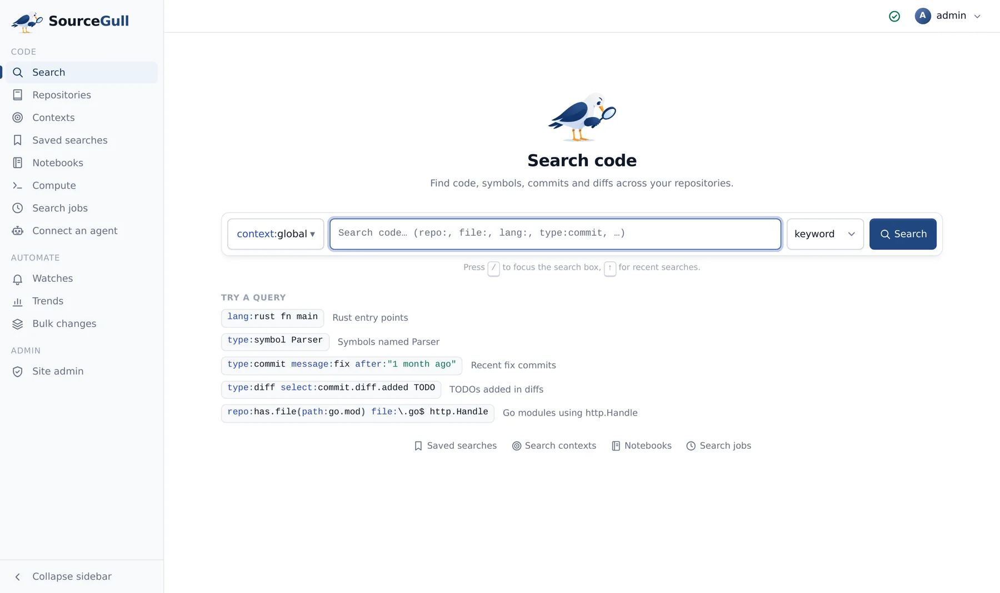
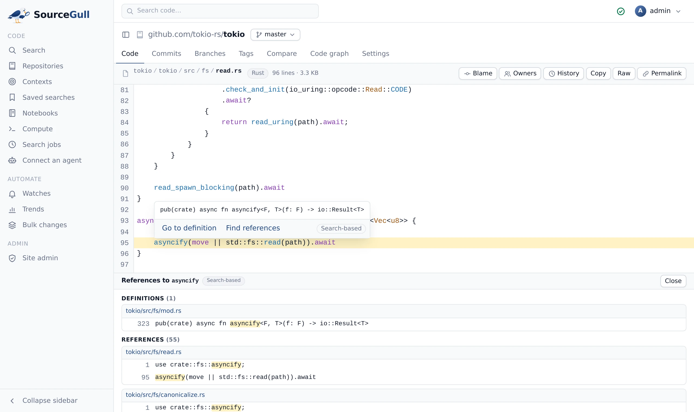

<p align="center">
  <br />
  
</p>

<p align="center">
  <strong>Fast, self-hosted code search and code intelligence for humans and agents, written in Rust.</strong><br />
  For GitLab, GitHub and Gitea. Every feature is open source under Apache-2.0, including SSO, SCIM, RBAC and audit logs. There is no paid tier, and there will not be one.
</p>

<p align="center">
  <a href="#quick-install">Quick install</a> ·
  <a href="docs/install.md">Production install</a> ·
  <a href="docs/README.md">Documentation</a> ·
  <a href="docs/search.md">Query language</a> ·
  <a href="docs/mcp.md">AI agents (MCP)</a> ·
  <a href="docs/architecture.md">Architecture</a> ·
  <a href="docs/development.md">Development</a>
</p>

<p align="center">
  <a href="#licence"></a>
  
  
</p>

<p align="center">
  <picture>
    <source media="(prefers-color-scheme: dark)" srcset="docs/assets/readme-search-dark.webp" />
    
  </picture>
</p>

## Fast search

Sourcegull uses a trigram index of its own. After a push, only the changed paths are written to a
delta shard, so new commits are searchable within seconds without rebuilding the repository's
index. Small repositories are packed together into compound shards, which keeps instances with
thousands of repositories fast. Revisions that are not indexed (any branch, tag or commit) are
searched straight from git. Results stream as they are found.

How it compares with the alternatives on the same GitLab:
[Benchmark](#benchmark-the-same-gitlab-one-product-at-a-time).

## Everything is free

Every feature is in this repository under Apache-2.0. There is no enterprise edition, no licence
key and no paid tier, and the project will not add one. That includes the features that other
code search products usually sell separately:

- Single sign-on with GitLab, GitHub or Gitea OAuth, OpenID Connect or an authenticating proxy
  (HTTP header), and
  [SCIM provisioning](docs/permissions.md#scim-provisioning).
- [Roles (RBAC)](docs/permissions.md#roles-rbac),
  [repository permissions synced from GitLab](docs/permissions.md#repository-permissions) and
  enforced on every read, and an [audit log](docs/permissions.md#audit-events).
- [Precise code navigation](docs/code-navigation.md) from SCIP indexes, across repositories and
  package versions, uploaded from GitLab CI or built by auto-indexing, with search-based results
  filling in for repositories that are not indexed.
- [Bulk changes](docs/bulk-changes.md): one YAML spec changes many repositories, then opens
  and tracks the GitLab merge requests.
- [Trends](docs/features.md#trends), [watches](docs/features.md#watches)
  and exhaustive [search jobs](docs/search.md#search-jobs) with CSV/JSONL export.
- Repository storage across [several repo nodes](docs/architecture.md#repo-nodes-and-rebalancing),
  added or removed without downtime.
- [Usage analytics](docs/features.md#usage-analytics) that stay on the instance.
- An [MCP server](docs/mcp.md) for AI coding agents.

Also included: literal, regexp, keyword (BM25) and structural search; notebooks; code ownership;
saved searches and search contexts; a GraphQL API, the `gull` CLI and outbound webhooks; Grafana
dashboards and documented alerts. See [the documentation](docs/README.md).

<picture>
  <source media="(prefers-color-scheme: dark)" srcset="docs/assets/readme-codenav-dark.webp" />
  
</picture>

## Ready for production

- One Rust binary, and PostgreSQL 18 is its only stateful dependency. Nothing is sent to a
  vendor cloud.
- Docker Compose for one host, a Helm chart for Kubernetes. Every release is tested by
  upgrading from the previous one.
- Repository storage spreads across several repo nodes, which you can add or remove without
  downtime.
- Stored secrets are encrypted, and the keys rotate without a restart.
- Grafana dashboards and Prometheus alerts are included.
- Configuration as code: sign-in, code host connections and site admins come from files in git,
  and secrets come from the environment.
- GitLab (gitlab.com and self-managed) has every feature. GitHub (github.com and Enterprise
  Server) and Gitea support repository sync, permission sync, webhooks and sign-in.

## Quick install

To try Sourcegull or run it for a small team on one host, download the Compose bundle of the
[latest release](https://github.com/sourcegull/sourcegull/releases/latest) and start PostgreSQL
and Sourcegull with the published image, `ghcr.io/sourcegull/sourcegull` (linux/amd64):

```sh
curl -fsSL https://github.com/sourcegull/sourcegull/releases/latest/download/sourcegull-compose.tar.gz | tar -xz
cd sourcegull-compose
echo "POSTGRES_PASSWORD=$(openssl rand -hex 24)" > .env
docker compose up -d
```

Open http://localhost:7080. The first user to sign up becomes the site admin. Add a GitLab,
GitHub or Gitea connection under **Site admin → Code host connections**, and repositories start
cloning and indexing.

### Production deployments

[docs/install.md](docs/install.md) is the install guide. For production, use one of these:

- **Kubernetes (Helm)**, for larger installs and several repo nodes:
  [install.md → Kubernetes](docs/install.md#kubernetes-helm), with an external PostgreSQL and
  your own secret, size presets and [sizing](deploy/helm/sourcegull/SIZING.md). Every value is
  in the [chart README](deploy/helm/sourcegull/README.md).
- **Docker Compose, production layout** (`compose.production.yaml`, one container per role), for
  one host: [install.md → Production layout](docs/install.md#production-layout).

Running either one is covered by the docs on
upgrades ([Compose](deploy/docker/upgrade.md), [Helm](deploy/helm/sourcegull/README.md)),
[backups](docs/configuration.md#backups), [monitoring](docs/observability/README.md) and
[configuration as code](docs/configuration.md#configuration-as-code).

## AI agents (MCP)

`/.api/mcp` is a [Model Context Protocol](https://modelcontextprotocol.io) server. Coding agents
search code, read files, find symbols, definitions and references, and read history (log,
commits, compare, blame) with the caller's permissions, in output sized for a model's context.
**Connect an agent** in the sidebar gives copy-paste setup for Claude Code, Cursor, VS Code,
Codex, Gemini CLI, Zed, JetBrains and others, with a one-click token. For Claude Code:

```sh
claude mcp add --transport http sourcegull https://sourcegull.example.com/.api/mcp \
  --header "Authorization: Bearer <token>"
```

Tools and examples: [docs/mcp.md](docs/mcp.md).

## How it works

One binary, `sourcegull`, runs in roles: `web` (UI, APIs, search fan-out), `repo` (git storage,
index shards and search, partitioned across nodes), `worker` (background jobs) and `blob` (blob
store); `sourcegull supervise` runs them all in one process. `sourcegull executor` runs sandboxed jobs
in Docker or Kubernetes. PostgreSQL holds the data, job queues, leases and caches; there is no Redis.
Each repo node indexes and searches its own repositories; `web` parses the query, applies
permissions, fans it out to the nodes and merges the result streams. Details in
[docs/architecture.md](docs/architecture.md).

## Build from source

Everything runs in Docker; nothing to install but Docker with Compose.

```sh
docker compose up -d          # Postgres, Sourcegull built from this checkout, UI dev server
open http://localhost:5173    # UI with hot reload; API on :7080
scripts/dev test              # the test suite against the dev Postgres
scripts/dev check             # rustfmt, clippy -D warnings, UI type check and tests
scripts/dev help              # e2e tests, benchmarks, a local GitLab with seed data, ...
```

More in [docs/development.md](docs/development.md).

## Alternatives

| | Sourcegull | [Sourcegraph](https://sourcegraph.com) | [Sourcebot](https://github.com/sourcebot-dev/sourcebot) | [Zoekt](https://github.com/sourcegraph/zoekt) | [OpenGrok](https://github.com/oracle/opengrok) | [Hound](https://github.com/hound-search/hound) | GitLab code search |
|---|---|---|---|---|---|---|---|
| Licence | 🟢 Apache-2.0 | 💰 proprietary | 💰 MIT core, paid plans | 🟢 Apache-2.0 | 🟢 CDDL-1.0 | 🟢 MIT | 💰 GitLab tiers |
| Every feature free | 🟢 | 🔴 | 🔴 | 🟢 | 🟢 | 🟢 | 🔴 |
| Written in | Rust | Go, TypeScript | TypeScript (Zoekt inside) | Go | Java | Go | Ruby, Go |
| Indexed regex search | 🟢 | 💰 | 🟢 | 🟢 | 🟢 | 🟢 | 💰/🟡 beta |
| Unindexed revisions (any branch, tag, commit) | 🟢 | 💰 | 🔴 | 🔴 | 🔴 | 🔴 | 🔴 |
| Structural and BM25 keyword search | 🟢 | 💰 | 🔴 | 🔴 | 🔴 | 🔴 | 🔴 |
| Code hosts | 🟢 GitLab, GitHub, Gitea | 💰 many | 🟢 many | 🟡 mirror tools | 🟡 local checkouts (many VCS) | 🟢 git and others | 🟢 GitLab only |
| Precise code navigation (SCIP), cross-repository | 🟢 | 💰 | 🔴 | 🔴 | 🔴 | 🔴 | 🟡 within one project |
| Repository permissions synced from the code host | 🟢 | 💰 | 💰 | 🔴 | 🔴 | 🔴 | 🟢 built in |
| SSO, SCIM, RBAC, audit log | 🟢 | 💰 | 💰 SSO free, rest paid | 🔴 | 🔴 | 🔴 | 💰 partly paid |
| Bulk changes across repositories | 🟢 | 💰 | 🔴 | 🔴 | 🔴 | 🔴 | 🔴 |
| Trends, watches, search jobs | 🟢 | 💰 | 🔴 | 🔴 | 🔴 | 🔴 | 🔴 |
| MCP server for AI agents | 🟢 | 💰 | 💰 | 🔴 | 🔴 | 🔴 | 💰/🟡 beta |
| Hosted AI assistant | 🔴 | 💰 | 💰 | 🔴 | 🔴 | 🔴 | 💰 |

🟢 free · 💰 paid · 🟡 incomplete · 💰/🟡 paid and incomplete · 🔴 not available

- **Sourcegraph** is the most complete code intelligence platform, self-hosted under a commercial licence.
- **Sourcebot** builds a web UI, an MCP server and an AI assistant on Zoekt; the MCP server, the
  assistant, permission syncing, analytics and audit logs are in paid plans.
- **Zoekt** is a fast trigram search engine and nothing else. It answers literal queries faster
  than Sourcegull; Sourcegull indexes faster, needs less disk and answers regexps faster (below).

### Benchmark: the same GitLab, one product at a time

Each product indexed the same 1,007 public projects from one GitLab CE 19.4 instance: 7 large
repositories at pinned releases (Linux, LLVM, Go, Rust, Kubernetes, GitLab, TensorFlow; 4.4 GB of
source) and 1,000 generated repositories with history (0.84 GB). Every product ran alone, from a
fresh install, next to GitLab on one host with 6 CPUs and 24 GB of memory.

| | All repositories searchable | Peak memory (indexing) | Memory (idle) | Disk | Selective literal | Common literal | Regex | No match |
|---|---:|---:|---:|---:|---|---|---|---|
| **Sourcegull** | 3 min 21 s | **3.7 GB** | 2.2 GB | **3.7 GB** | 54 / 69 ms (724) | 48 / 54 ms (1000) | **84 / 88 ms** (1000) | 29 / 35 ms (0) |
| Sourcegraph 5.0.6 | 10 min 08 s | 5.2 GB | 3.2 GB | 13.4 GB | 22 / 33 ms (640) | **24 / 30 ms** (902) | 121 / 242 ms (883) | 12 / 20 ms (0) |
| Sourcebot 5.1.16 | 5 min 31 s | 8.5 GB | 1.9 GB | 13.9 GB | 77 / 90 ms (660) | 101 / 113 ms (971) | 309 / 332 ms (978) | 18 / 21 ms (0) |
| Zoekt | 9 min 05 s | 3.9 GB | **1.7 GB** | 13.9 GB | **16 / 23 ms** (724) | 29 / 34 ms (1000) | 361 / 390 ms (1000) | **8 / 10 ms** (0) |
| Hound | **3 min 02 s** | 6.2 GB | 5.9 GB | 9.4 GB | 336 / 351 ms (724) | 766 / 851 ms (2188) | 788 / 884 ms (2187) | 10 / 13 ms (0) |
| OpenGrok 1.14 | 36 min 38 s | 9.0 GB | 5.1 GB | 18.4 GB | 973 / 998 ms (653) | 84 / 107 ms (1000) | not supported | 20 / 27 ms (0) |

- **Searchable**: from adding the GitLab connection (or starting the product, when it reads its
  configuration from a file) until every repository is in the search index, cloning included.
- **Memory**: all of the product's containers, databases included, as Docker reports them: the
  peak while indexing, and after two idle minutes. **Disk**: all of its volumes (git mirrors,
  index, databases).
- **Queries**: p50 / p95 of 20 sequential requests after 3 warm-ups, over HTTP to each product's
  search API, at most 1,000 results; files returned in parentheses. Selective is `kmalloc_array`,
  common is `func main`, regex is `func\s+main\(`, and the last query matches nothing. Sourcegraph
  and Sourcebot stop at 1,000 line matches, so they return fewer files; Hound has no limit and
  returns every matching file.
- Settings are the defaults, except: Zoekt (`zoekt-indexserver` and `zoekt-mirror-gitlab` built
  from commit c0b97d2) runs with `-fetch_interval 1m` (the default of one hour delays the first
  index by an hour) and `-cpu_fraction 1.0`; Hound runs 6 indexers. OpenGrok has no code host
  integration, so its time includes cloning every repository first (6 at a time, 86 s); its
  regexps match single tokens, so the regex query cannot be expressed.
- Sourcegraph 5.0.6 is the single-container image from 2023, before the source was closed.
  Sourcebot 6 needs the deployment registered with the vendor before its API answers, so 5.1.16,
  the last release without that, was measured. GitLab's own code search is not included: GitLab CE
  searches code one project at a time, and instance-wide search needs Elasticsearch on a paid tier.

## Contributing

Bug reports and pull requests are welcome. [docs/development.md](docs/development.md) covers the
Docker development setup, tests, benchmarks and conventions. Run `scripts/dev check` before
sending a change.

## Licence

Apache-2.0 ([LICENSE-APACHE](LICENSE-APACHE)). Parts derived from third-party projects keep
their licence and attribution; see [NOTICE](NOTICE).

Sourcegull is independent and not affiliated with, sponsored or endorsed by Sourcegraph, Inc. or
GitLab Inc. Product names are trademarks of their owners, named only to describe alternatives
and compatibility.
